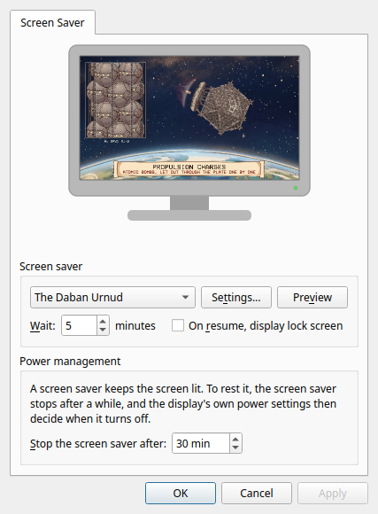

# screensaver-service

Screen savers for Wayland desktops: a small service that starts one when the
session is idle, and a settings window in the classic arrangement.

## Why

On X11 a screen saver was a standard part of the desktop. On Wayland there is no
screen saver service at all: the old X11 mechanism does not exist, and desktops
that moved to Wayland mostly dropped theirs. The screen savers themselves are
still packaged, a couple of hundred of them, with nothing to run them.

This fills the gap without reviving the parts that caused trouble. It does not
lock the screen and it is not a security boundary; it only shows something while
you are away.

## What is in it

- **screensaverd**, the service. It asks the compositor when the session is idle
  (the ext-idle-notify-v1 protocol), starts a screen saver, and stops it when you
  come back. Because idleness comes from the compositor, a video player or
  presentation that inhibits idling holds the screen saver off as well.
- **screensaver-settings**, the settings window: a picture of a monitor showing
  the screen saver chosen, a list with *(None)* and *(Random)*, *Settings* and
  *Preview* buttons, how long to wait, and whether to lock on return.
- **A page in KDE System Settings**, under Display & Monitor, with the same
  controls. It is a separate package, so the rest has no KDE dependencies.
- **screensaverctl**, the same settings from the command line.

It works on compositors that provide ext-idle-notify-v1: KDE Plasma, Sway,
Hyprland, niri, COSMIC, labwc and others.

## Which screen savers it runs

**X11 screen savers** in the xscreensaver tradition, which draw into a window
they are given. The service finds them through the desktop entries in
`/usr/share/applications/screensavers/`, the same ones the MATE, Xfce and Cinnamon
screen savers read, makes a full-screen window on each monitor through Xwayland,
and hands it over in `XSCREENSAVER_WINDOW`. On Fedora:

    sudo dnf install xscreensaver-extras-gss xscreensaver-gl-extras-gss

**Standalone screen savers**, which are ordinary programs that go full screen by
themselves. One registers by installing a desktop entry in
`/usr/share/screensaver-service/savers/` (or the same under `~/.local/share`):

    [Desktop Entry]
    Type=Application
    Name=The Weed War
    Comment=Fraa Lio fights the Battle of Trantae with weeds
    Exec=weed-war
    TryExec=weed-war
    X-Screensaver-Snapshot=weed-war --snapshot %o --size %wx%h --time 60
    X-Screensaver-Settings=weed-war --configure

`X-Screensaver-Snapshot` is optional: a command that writes a still picture, shown
on the monitor in the settings window (`%o` is the file to write, `%w` and `%h`
its size). `X-Screensaver-Settings` is optional too: a command that opens the
screen saver's own options, for the *Settings* button.

## Locking

The service never locks the screen. If *On resume, display lock screen* is
ticked, it asks the session to lock (`loginctl lock-session`) when you come back,
and your desktop's own lock screen takes over. Screen savers that try to be
lockers as well are where the security bugs have always been; a lock screen
should be the compositor's business.

## Resting the screen

A screen saver keeps the display lit. By default the service stops it after half
an hour so that the display's own power settings can turn the screen off. That
time is in the settings window, and can be set to never.

## Install

Fedora and Nobara packages are on the [releases page](../../releases):

    sudo dnf install ./screensaver-service-*.rpm ./screensaver-service-kcm-*.rpm

Then open *Screen Saver* from the application menu, or System Settings, Display &
Monitor, Screen Saver. Choosing a screen saver and pressing OK turns the service
on. From a terminal:

    systemctl --user enable --now screensaverd
    screensaverctl list
    screensaverctl wait 10
    screensaverctl test weed-war

## Build

Needs a C and a C++ compiler, Meson, wayland-client, wayland-protocols 1.27 or
newer, libX11, libXrandr and Qt 6 Widgets. scdoc builds the manual pages, and KF6
KCMUtils builds the System Settings page; both are optional.

    meson setup build
    meson compile -C build
    sudo meson install -C build

`tools/Containerfile` describes a container with everything, and
`tools/build-rpm.sh` builds the RPMs in it.

## What it does not do

- It does not lock, and does not try to stop anyone using the machine.
- It does not work under GNOME, which does not provide the idle protocol.
- It does not embed a live preview in the settings window; the monitor shows a
  still. *Preview* runs the real thing full screen.
- X11 screen savers need Xwayland.

## Licence

MIT.
